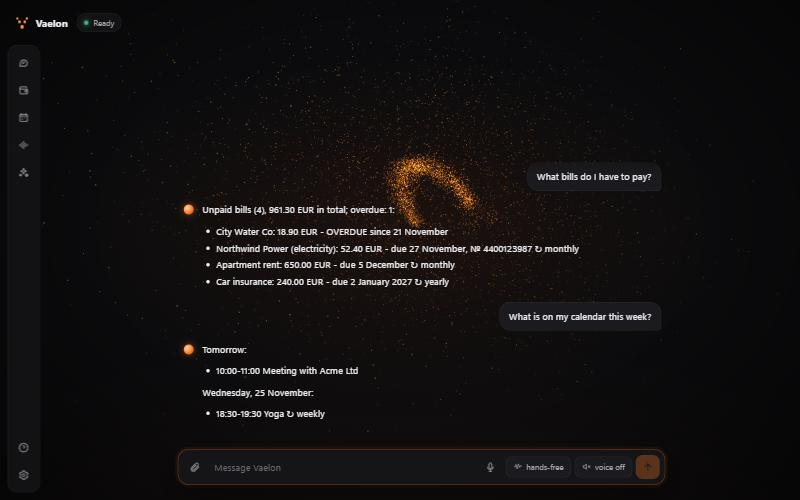

# VAELON

<p align="center"></p>

**Your private AI assistant, on your own computer.** Talk to it or type: it answers, writes real documents, keeps your
bills, invoices, budget and calendar in order - and asks before it does anything that matters. Free and open source.

**[Download for Windows](https://github.com/Nokk1251/vaelon/releases/download/v0.18.0/Vaelon-Setup-0.18.0.exe)** ·
**[Download for Mac](https://github.com/Nokk1251/vaelon/releases/download/v0.18.0/Vaelon-0.18.0.dmg)** (Apple silicon) ·
[Website](https://nokk1251.github.io/vaelon/) · [Getting started](docs/GETTING_STARTED.md) · [All releases](https://github.com/Nokk1251/vaelon/releases)

<p align="center"></p>

## Why try it
- **Private by default.** It thinks with a local model on your own computer (Ollama). A cloud model is your choice,
  with your own key, and the app says plainly when text leaves the computer. No account, no telemetry.
- **It asks before it acts.** Deleting, sending, running a program or writing where programs start by themselves waits
  for your yes on an approval card that the AI cannot press for you - even when a web page or a file tries to talk it
  into something.
- **It does the work, not just the talking.** Word, PDF, Excel and PowerPoint files; bills with reminders, invoices, a
  monthly budget, deals and bank-statement import for freelancers and small businesses; calendar, reminders, voice and
  a small always-on-top companion window.

**Vaelon - originally created by [Nokk_7](https://github.com/Nokk1251).** This credit must stay in every copy and modified version (see [NOTICE](NOTICE)).
Combines the best ideas of OpenJarvis, Jarvis, Ultron and JARVIS projects (see [docs/ANALYSIS.md](docs/ANALYSIS.md)).

## Install and start

| | Windows 10 / 11 | macOS 14 or later, Apple silicon (M1 or newer) |
|---|---|---|
| Download | `Vaelon-Setup-<version>.exe` from the release page | `Vaelon-<version>.dmg` from the release page |
| Install | run it (one administrator prompt; installs into Program Files) | open the .dmg and drag **Vaelon** onto **Applications** |
| First launch | SmartScreen may say "Windows protected your PC": **More info** > **Run anyway** (the app is not code-signed) | macOS says it cannot check the app: **System Settings > Privacy & Security** > **Open Anyway**, then confirm (once; the app is signed ad hoc, not notarised) |
| Start it later | Start menu > **Vaelon** (or the desktop shortcut, if you chose one) | **Applications** > **Vaelon**, Launchpad or Spotlight |
| Microphone | Settings > Privacy & security > Microphone: let desktop apps use it | macOS asks once; to change it later: System Settings > Privacy & Security > **Microphone** > Vaelon |
| Your data | `%USERPROFILE%\.vaelon` | `~/.vaelon` |
| Uninstall | Settings > Apps > Vaelon > Uninstall | drag Vaelon from Applications to the Bin |

To update, run the new installer over the old version. Updating or uninstalling never removes your data folder or the files Vaelon made for you (`Documents\Vaelon`).
Settings > Updates can tell you when a new version is out (off by default; it asks GitHub only for the version
number and never downloads anything by itself).
Compare a download with `SHA256SUMS.txt` on the release page if you want to be sure it was not changed.

**The first start** opens a short setup. The one choice that matters is **where Vaelon thinks**:
- **On this computer** (private, nothing leaves it): install the free **Ollama** app - the setup has a
  **Get Ollama** button that opens its download page - then pick a model and press **Download the model** (with a
  progress bar; no terminal needed). The list shows what each model is good for, its size, how much memory it needs,
  whether it fits this computer and how fast it will feel, and recommends one for this computer (`qwen3:4b-instruct`,
  2.5 GB, on most laptops).
- **In the cloud** (faster, your text goes to that company): paste your own key (Groq and Gemini have free plans) into
  the key box of the setup or of Settings - never into the chat.

Without a model Vaelon still answers simple things at once (time, weather, prices, calendar, bills), but conversations,
files, documents and research need one. It speaks with your computer's own voice; see Help > Voice.

### From source (developers)
```bash
pip install -e ".[all]"          # Python 3.10+
ollama pull qwen3:4b-instruct    # local model (nothing leaves your PC)
vaelon doctor
vaelon app                       # desktop app (native window); needs: cd ui/web && npm install && npm run build
vaelon chat                      # or: vaelon run "organize my Downloads folder"
vaelon voice                     # say: "Vaelon, ..." (local Whisper, understands many languages)
vaelon telegram                  # control from your phone
```
Cloud model instead: `vaelon config provider anthropic` + `vaelon config model claude-sonnet-5-5`, then set `ANTHROPIC_API_KEY`.

## What it can do
Files (list/read/search/write/move/trash/permanent delete) - web search/fetch/download - shell and apps - processes - email (SMTP/IMAP) - SMS and **phone calls** (Twilio) - encrypted contacts, all set up in Settings > Phone and email - memory - self-written tools - sub-agents (coder, researcher, operator, comms) - undo.

Plus: self-verifying coding (`code_task`: write -> compile/syntax check -> fix, learns from its fixes), GitHub code research (`research_code`, licence-aware), self-study sessions (`vaelon study`, schedule nightly), extension manager, document/screen reading.

## Desktop app
`vaelon app` runs the core and opens a native window (Edge WebView2 on Windows, WebKit on macOS). To build the apps:
`python scripts/build_app.py` -> `dist/Vaelon/Vaelon.exe` and the installer with `installer/vaelon.iss` (Inno Setup 7)
on Windows; `python3 scripts/build_mac.py` -> `dist/Vaelon.app` and `dist/Vaelon-<version>.dmg` on a Mac. The
`release` workflow builds both. Ollama is installed separately.

## Create files: documents, spreadsheets, slides, audio
Ask for the file, not just the text - Vaelon writes the content and saves a real file in `Documents/Vaelon`:
- **Documents** - "Write a one-page report about solar energy and save it as PDF" (`create_document`: Word, PDF,
  Markdown, text; headings, lists, tables, code; Cyrillic works in PDF).
- **Spreadsheets** - "Make an Excel table with a monthly budget" (`create_spreadsheet`: real numbers, header, filter).
- **Presentations** - "Create a 6-slide presentation about black holes" (`create_presentation`: 16:9, speaker notes).
- **Audio and podcasts** - "Read this article aloud into a file", "Make a two-voice podcast about ..."
  (`create_audio`: WAV, made with the LOCAL voice only - no cloud credits, no text leaves the PC; about one minute of
  work per minute of audio on a laptop CPU; up to ~20 minutes).
Every created file gets a card in the chat: **Open**, **Show in folder**, and **Play** for audio. A file is never
overwritten, every creation can be undone, and the app can only open documents from that one folder - never programs.

## Deep research
`/research <topic>` (or "do a deep research on ..."): Vaelon plans 4-6
searches, runs them at the same time, reads the best pages in parallel (at most two per site, pages with Guardian
warnings are skipped), and writes a report with numbered references. The source list is built from the pages that
were really read, so links cannot be invented. The report is also saved as a Word file. Measured: ~20 s with Groq.

## Reminders and scheduled tasks
- "Remind me in 20 minutes to call mum", "Remind me tomorrow at 9 to pay the electricity bill" - the time is read by code, so it is
  exact. When it fires you get a system notification (Windows or Mac) and a line in the app (read aloud when the voice is on).
  Reminders are stored encrypted and survive a restart.
- "Every day at 08:00 give me a morning briefing" (`schedule_task`): the result arrives the same way. Unattended
  runs can never do dangerous actions.

## Attach files and pictures (vision)
Press the paperclip, paste, or drop a file on the command bar: pictures (png, jpg, webp ...) and documents (pdf,
docx, xlsx, pptx, txt, csv ...). Vaelon looks at the picture or reads the document first and then answers.
- With a **local** model the local vision model looks at pictures (`ollama pull gemma3:4b`) - nothing leaves the PC.
- With a **cloud** model the picture or document text goes to that same provider. On Groq the vision model
  `qwen/qwen3.8-27b` is used automatically (`vaelon config vision_cloud_model <name>` to change it).
- Vaelon never invents the content of a file or picture it was not shown - it asks for it.

## Several tasks at once
You do not have to wait for one answer before asking the next: up to four requests run at the same time, each on its
own agent (same memory, same safety rules, one shared conversation).
- The swarm **splits into one cluster per task** - each with its own colour and shape (a quiet shell while queued, a
  vortex while thinking, orbiting rings while a tool runs). When a task ends its cluster bursts and the matter flows
  back into one body.
- Every task has a **label** on its cluster. Click it to open the inspector: each step with its time and what it
  looked up, the answer as it is being written, and a Cancel button. `/stop` cancels everything.
- Answers of parallel tasks are marked with their question and colour, so nothing gets mixed up.
- With a cloud model the tasks really run in parallel. A local model on a CPU takes them in turn.

## The companion: a small floating window you talk to
Press **hands-free** (or type `/talk`). The big window steps aside and a **small window that stays on top of
everything** appears in the corner. Drag it anywhere, keep working, and just talk to it:
- a live orb shows what it is doing (listening, hearing you, thinking, looking, speaking), with your last words
  and its answer next to it;
- **eye** - let it see your screen. While the eye is on (the frame turns blue), a question that points at the
  screen ("what does this error say?", "what is written here?") makes it look first and then answer. Without the eye,
  looking at the screen always needs your approval. With a cloud model the screenshot goes to that provider; with
  a local model it stays on the PC. Nothing is captured unless you ask about the screen;
- **microphone** - switch listening off for a moment; **stop** - cancel; **expand** - back to the full window.
  Everything said in the companion also appears in the full window's conversation.
- `/talk here` keeps the old behaviour: hands-free inside the big window.

### Live voice (optional, real-time)
The bolt button in the companion switches to **Live**: a real-time conversation through Google's Gemini Live. It
answers in about 1.5-2 seconds, you can talk over it at any moment, and with the eye on it sees your screen
continuously (a picture every 3 seconds) - "what does this error say?" is answered straight away.
- It needs a Gemini key (`vaelon key set GEMINI_API_KEY`; the free tier works) and `pip install "vaelon[live]"`.
- **Privacy: while Live is on, your microphone audio streams to Google - and with the eye on, pictures of your
  screen too.** The companion shows a LIVE tag the whole time; one click on the bolt goes back to the normal voice.
- The key never reaches the page: the app talks to a local bridge in the core (127.0.0.1), the bridge talks to Google.
- The Live model only talks. Everything real - web, files, the computer, reminders, documents - is done by Vaelon
  itself through one function, with the same approvals and safety rules as always.
- The voice is one of Google's (`vaelon config live_voice Charon`); the Voice Designer does not apply to it.

The normal conversation works like this - the microphone stays open and you simply talk:
- Vaelon cuts each phrase out by itself (it ends ~0.7 s after you stop), transcribes it, answers, and reads the answer.
- **Speak over it to interrupt** - it pauses at once; a real sentence stops the old answer and starts the new one, a
  cough or a short "ok" lets it carry on. Its own voice from the speakers is recognised and ignored.
- Say **"stop"** to cancel everything.
- Spoken answers are short on purpose (one to three sentences) unless you ask for details.
- Measured with Groq + the local voice: about 3 s from the end of your sentence to the first spoken word.
- Privacy: audio is never saved. With a local model it never leaves the PC; with Groq the phrase goes to Groq.

## Speed
- **A spoken exchange under two seconds (with fast cloud services):** transcription starts at the first short
  pause, the connections are opened while you are still talking, the answer is spoken sentence by sentence while it
  is being written, and the local voice needs 0.1-0.3 s per sentence. Type `/speed` to see your own numbers after
  every answer: your words as text, first words, first sound - counted from the moment you stopped talking.
  The cloud voice (ElevenLabs) streams: each sentence starts to sound while it is still being generated, with the
  Voice Designer effects applied piece by piece; a sentence said before comes from the cache without new credits.
  With the local model on a CPU the model itself takes seconds; nothing around it can change that.
- **Several lookups in one step:** when a cloud model asks for several read-only tools at once (three pages, two
  cities) they run at the same time. Tools that change something still run one by one, with approval.
- **Lookup cache:** a repeated search, page, weather or price is reused for a short time (1-60 minutes by kind).
- **Direct answers (~1 s, no model):** stocks ("how did Nvidia do the last 3 days"), crypto, weather, exchange rates,
  time/date/RAM, "remember that ...", "what do you know about me", help. Encyclopedia questions are pre-fetched from
  Wikipedia so the model only has to phrase the answer (a spoken "what is ..." to a cloud model skips this to save
  half a second). Small local models often refuse to use tools - this removes
  that failure for the most common questions.
- **Stable everyday toolbox:** the prompt is identical between requests, so Ollama reuses its cache; the model is
  pre-loaded and the prompt pre-read when the core starts.
- Answers are length-capped and structured output is enforced. Specialised tools join only when a request needs them.
- On a weak CPU with little free RAM, a 4B model still needs seconds per answer. For near-instant answers use a free
  cloud model (below) - at the cost of privacy.

## Smarter model (optional API keys, free tiers)
```bash
vaelon provider                 # list: local, groq, gemini, openrouter, cerebras, mistral, openai, anthropic
vaelon provider groq            # prints where to get the free key
vaelon key set GROQ_API_KEY     # paste it once - stored ENCRYPTED in the vault, never in config.json
vaelon models                   # models your key can use -> vaelon config model <name>
vaelon provider local           # back to fully private
```
Cloud providers receive your messages (secrets are redacted). `fallbacks` can keep the local model as a backup.

## Voice Designer
Shape the voice locally: pitch, speed, metal, robot, radio, echo, space - presets `vaelon`, `butler`, `titan`,
`machine`, `radio`, `ghost`, `clean`. In the app: ◉ button or `/voice` (live preview). CLI:
`vaelon voice-design --preset titan --set pitch=0.85 echo=0.3`. Studio-quality cloud voices (any language):
`vaelon key set ELEVENLABS_API_KEY` + `vaelon config tts_engine elevenlabs` (+ `elevenlabs_voice <id>` for a voice you
designed there) - text then goes to ElevenLabs; the designer effects still apply. No real person's voice is cloned.

## Microphone
The mic button next to the command box records one command and stops by itself when you stop talking; the answer is
spoken back. Speech-to-text: Groq Whisper (accurate in many languages, ~1 s) when Groq is already your model
provider, otherwise local faster-whisper (fully private): force local with `vaelon config stt_engine local`. Audio is
recorded as plain WAV, kept only in memory and never saved. The first time, Windows asks to allow the microphone.

## Memory that persists
The conversation survives restarts (encrypted), Vaelon picks up facts you state about yourself (name, city, work,
likes) into an encrypted profile and shows "Learned: ..." when it does. Menu → Memory shows everything it knows;
`/clear` starts a new conversation; `vaelon memory wipe` erases memory, profile and history.

## Guardian (built-in protection, local and defensive)
- Every link is checked for phishing/malware signs before it is opened; obvious ones are blocked.
- Every fetched page is scanned for malicious patterns (obfuscated JS, miners, scam text) and flagged.
- Every download is virus-scanned (Microsoft Defender / ClamAV) and quarantined if infected.
- `security_audit`: antivirus, firewall, open ports, autostart entries, processes from temp folders, plugin safety.
- `check_url`, `scan_file` on demand. Penetration testing is limited to your own machine - probing other people's
  systems without permission is illegal, so Vaelon does not do it.

## Encryption and integrity
- Private data is encrypted at rest with AES-256-GCM (`cryptography`); the master key is sealed with Windows DPAPI
  or, on a Mac, with a key kept in the macOS Keychain (only your account on this computer can open it). Memory search uses an HMAC blind index - no readable words on disk.
- The API key is sealed too (`vaelon token` prints it); the audit log is an HMAC chain that cannot be re-forged.
- Code integrity: SHA-256 fingerprints of every source file, signed with HMAC; checked at start-up and by
  `vaelon doctor` / `vaelon integrity verify`. After your own edits: `vaelon integrity sign`.
- Plugins and hooks run only if their exact content was approved (`create_tool` or `vaelon trust plugin <name>`).
- The source is open on purpose: encrypting open-source code adds no security; signing and sealed data do.
  The app is not code-signed (that needs a paid certificate), so on first launch Windows SmartScreen may warn ("More
  info" > "Run anyway") and macOS asks once (System Settings > Privacy & Security > "Open Anyway"). Compare the
  download with `SHA256SUMS.txt` on the release page.

## Free knowledge sources (no API keys, no accounts)
Wikipedia (any language), Open-Meteo weather, ECB exchange rates, CoinGecko, stock prices (Yahoo Finance chart data without a key; with a free key Vaelon prefers the official sources Twelve Data - quotes and history worldwide - and Finnhub - real-time US quotes: `vaelon key set TWELVEDATA_API_KEY`, `vaelon key set FINNHUB_API_KEY`), World Bank,
arXiv, Open Library, FreeToGame, Hacker News, OSV.dev, CISA KEV, NIST NVD. Plus 21 built-in skills (business,
investing research, books, games, science, computers, cyber-defence, legal hacking practice, geopolitics, economics,
history, writing, learning...). Investing tools give data, not personal advice.

## Profiles (optional)
Settings > Profiles (also in the first-run setup): **Business**, **Learning**, **Coding**, **Creator**, **Everyday
life** - pick none, one or several. A profile keeps a few of its tools always ready (they work without the usual
words), adds one line about how you like to be helped and puts its examples first in the menu. Nothing is switched off
and no right is granted.

## Help and feedback
The **?** button (or `/help`) opens the Help page: every part of Vaelon explained, with search. **Feedback** there
(`/feedback`) saves an idea or a problem as a text file in `Documents\Vaelon\Feedback` - your words, the version and
whether the model is local or cloud; nothing is sent by itself.

## Safety model
- **SAFE** runs. **REVERSIBLE** runs and can be undone (`undo`). **DANGEROUS** needs your yes in the terminal/Telegram; the model cannot approve for itself.
- Content from web/email/files is fenced as data; after reading it, any state change needs confirmation (prompt-injection defence) - and so does opening an address the model made up (it could carry your data out), remembering, forgetting, undoing or delegating. Writing programs or into places where files start by themselves always needs your yes.
- Files confined to `allowed_roots`; `.ssh`, `.env`, etc. are blocked. SSRF guard on all fetches.
- Secrets only from environment variables, redacted from model input (cloud), memory and audit log. `vaelon audit` verifies the log; `vaelon memory wipe` erases memory.

## Settings, keys and first-run setup (in the app)
The gear button (or `/settings`) opens Settings: what Vaelon calls you, where it thinks (local model or a cloud
provider), the model, voice and speech-to-text engines, learning, and all API keys. A brand-new installation starts
with a four-step setup that can be skipped.
- **Keys are entered in a password box and go one way**: app -> local core -> encrypted vault (DPAPI + AES-256-GCM).
  They are never displayed again; no endpoint returns a key, a part of it or its length; only the key's NAME is
  written to the audit log. Only key names Vaelon knows are accepted. `vaelon key set` in a terminal still works.
- A cloud provider can be chosen only after its key is stored, and the screen says that your messages will be sent
  to it. One click on **local** makes everything private again.
- Not changeable from the app, on purpose: allowed folders, tools that skip approval, a custom server address, MCP
  servers. Those stay in the terminal / config file.

## Calendar
The ▦ button (or `/calendar`) shows the next two weeks; add an appointment there or just say it: "add a dentist
appointment on Friday at 10", "put lunch with Ana on 20.11 at 13:00 for 90 minutes", "what do I have tomorrow?". Events can
have a place, notes, a reminder (15 minutes before by default) and a repeat (daily, weekly, monthly, yearly); one
date of a repeating event can be skipped. Overlaps are pointed out. Vaelon reminds you with a system notification
and a line in the app. Export to / import from .ics (Google Calendar, Outlook, phones). Everything is stored
encrypted in `~/.vaelon/calendar.enc`; nothing is synced anywhere unless you export it yourself.

## Bills and invoices
The ¤ button (or `/bills`) keeps the bills you have to pay, the ones you paid, the invoices you issue and your
business details. **Vaelon never pays anything** - you pay in your bank and press Paid (or say "I paid the electricity bill").
- Add a bill by saying it ("add a bill: electricity 45.20 EUR due 25.11", "add a bill: rent 400 EUR due 1.12 every
  month"), in the panel, or by attaching its PDF / photo and saying "add this bill".
- Reminders come a few days before the due date (default 3), on the day, and once when it is overdue.
- A repeating bill brings the next one (same amount, marked `~` as expected) when you pay it; the real bill replaces it.
- "What bills do I have to pay?", "how much did I pay for electricity this year?", "who owes me?" are answered at once.
- Invoices: numbered in one unbroken 10-digit series, with your business details, VAT and a due date, as a PDF in
  English or another language. An invoice is never deleted, only voided. This is a helper, not certified accounting
  software - check the details with your accountant.
- Export everything to Excel. Stored encrypted in `~/.vaelon/bills.enc`.

## Budget
The ¤ button opens "Money"; its first tab is the budget of a month: income, spending per category against its
limit, what is left. Say it as you go - "spent 30 EUR on groceries", "spent 12 EUR on coffee", "got paid 2000
EUR salary" - and set limits the same way ("set a budget of 400 EUR for groceries", "set a budget of 1500 EUR" for all
spending). "How is my budget?" and "how much is left for eating out?" are answered at once, and an expense that
crosses 80 % or the limit is pointed out right away. Bills you marked paid count by themselves. One budget currency
(EUR by default). It is a record you keep - Vaelon never moves money. Stored
encrypted in `~/.vaelon/budget.enc`.

## Deals
Money > Deals (or `/deals`) is a small sales pipeline: each deal has a client, a value, a stage (lead, contacted,
proposal, negotiation, won, lost - with the usual chance of closing, so you see the expected value), an expected
close date, a next step with a date (Vaelon reminds you that day) and a log of notes. Say it as it happens - "new
deal with Acme: website 5000 EUR", "move Acme to proposal", "follow up with Acme on Friday", "we won the Acme deal" -
and a won deal becomes an invoice in one click. Stored encrypted in `~/.vaelon/deals.enc`.

## Bank statements
Money > Budget > **Import bank CSV** (or attach the file and say "import this bank statement"). Download the statement as
CSV in your online banking (most banks, Revolut, Wise ...). Vaelon reads it on this computer, shows what it found,
and only then records it: payments that match an unpaid bill mark the bill paid, incoming payments that match an
invoice mark it paid, the rest become budget entries. Nothing is imported twice. Vaelon never logs in to a bank.

## Exams, birthdays and other life events
"I have a history exam in 4 days" - saved in the calendar, and Vaelon offers a study plan; tell it the topics and
how much time you have, and every study session lands in the calendar, the last day a mock exam. "Mum's birthday is
on 12 March" - remembered every year, with a reminder the day before at 9:00.

## Try it with demo data
`vaelon demo load` (or say "load demo data") fills Money and the calendar with made-up entries; "remove the demo
data" removes exactly those and nothing of yours.

## Company mode
Money > Company (or `vaelon company enable`) turns Vaelon into a small team's assistant: several companies, each
with its own bills, invoices, budget, deals and journal; people with roles (owner, accountant, sales, member, viewer)
and a PIN; a Lock button; a journal of who changed what, encrypted and tamper-evident. Everyone who is not the owner
works in **work mode**: no access to the owner's memory, conversations, calendar, files or settings. Accounting
software with an MCP server (Xero, QuickBooks Online) can be connected - see `docs/ACCOUNTING.md`. On one Windows
account this guards against mistakes and casual misuse; separate Windows accounts give real separation.

## Several conversations
The ❏ button (or `/chats`) lists your conversations: open an earlier one, rename or delete it; `/new` starts a fresh
one and `/clear` erases the messages of the open one. Vaelon only sees the open conversation (what it learned about
you in Memory is shared by all). Every conversation and the list of titles are stored encrypted in `~/.vaelon/chats`.
Switching is refused while a task is still running, so an answer never lands in the wrong conversation.

## Web search
`web_search` asks the best source that answers: **Tavily** or **Brave Search** if you stored a free key
(`TAVILY_API_KEY`, `BRAVE_SEARCH_API_KEY` - official APIs, the reliable choice), otherwise several public engines
without a key (they throttle automatic requests now and then), and finally Wikipedia. Only the search words are
sent. `vaelon doctor` shows which sources are active.

## Connect outside tools (MCP)
Vaelon speaks the [Model Context Protocol](https://modelcontextprotocol.io), the common standard for giving tools to
AI agents, so the many ready-made MCP servers (files, GitHub, databases, calendars, browsers ...) work with it.
```bash
vaelon mcp add files -- npx -y @modelcontextprotocol/server-filesystem C:\Users\you\Documents   # a local program
vaelon mcp add notes --url https://example.com/mcp --key NOTES_TOKEN                              # a remote server
vaelon mcp list                      # servers, their tools, which ones run without asking
vaelon mcp allow files read_file     # let one tool run without the question
vaelon mcp refresh files             # look at the server again after it was updated
vaelon mcp disable files | enable files | remove files
```
Then just mention the server's name (or one of your `--words`) in a request: "use files to list my Documents".
- **Only you add servers.** `vaelon mcp add` shows the exact command or address and every tool before you confirm.
  The model has no way to add, change or enable one.
- **Every call asks first**, because what Vaelon passes to the tool leaves Vaelon. `vaelon mcp allow` lifts that
  for one tool - but never in a task that has already read outside content (a page, an e-mail, a file).
- **Tools are pinned.** If a server later changes a tool's description or arguments, that tool is blocked until you
  review it with `vaelon mcp refresh`. A tool whose description reads like instructions to the model is never offered.
- **Your keys stay yours.** A local server starts without your stored keys in its environment; it gets only the ones
  you name (`--env GITHUB_TOKEN=GITHUB_TOKEN`, stored with `vaelon key set`). Keys of model providers are never
  handed over. Remote servers must use https.
- **Nothing runs until used.** A server starts the first time one of its tools is called.
- Limits: no OAuth sign-in (use a token), no sampling/elicitation, not the deprecated HTTP+SSE transport of 2024.

## Extend
Drop `.py` plugins into `~/.vaelon/plugins` (use `@tool`), hooks into `~/.vaelon/hooks` (`register(hooks)`; return a string from `pre_tool` to veto), markdown skills into `~/.vaelon/skills`. Contacts: say "save Mum's number +1 555 0100" (kept encrypted in `~/.vaelon/contacts.enc`; an old `contacts.json` is moved in once).

## Self-learning and self-rewriting
- `learn` / `vaelon learn "topic"`: researches the web (or `--url`), distils facts, stores them in memory labelled with source and "unverified". Injection-looking text is dropped.
- `learn_skill`: saves a reusable procedure as a skill in `~/.vaelon/skills`. After multi-step tasks Vaelon reflects in the background and saves skills/lessons itself (`auto_learn`, never on turns that read outside content).
- `self_read` / `self_modify`: Vaelon can rewrite its own code. Every change shows you the diff, needs your approval, is tested against the full suite in a sandbox copy, and is applied only if all tests pass, with a backup. `vaelon evolution history|rollback`. The safety core (`security/`, `evolution.py`, `tools/registry.py`, `server.py`, `config.py`) and the tests can never be rewritten by Vaelon.
- Perception: `read_document` (pdf/docx/any text), `look_at_image` and `see_screen` via a local vision model (`vision_model`, default `gemma3:4b`).

Visual interface: `ui/web` - the Swarm, an original Next.js + Three.js interface (a formless murmuration that glitches
red). It breathes when idle, folds into a vortex with neural sparks while thinking, spins into orbiting rings while a
tool runs, and becomes a pulsing core that follows the voice while speaking. ☰ opens the menu with every example,
tool, skill, command, memory and key status. The interface is in English; Vaelon answers in the language you write in.

## Reliability
LLM calls retry with backoff and fall back through `fallbacks` (e.g. `[{"provider":"ollama","model":"llama3.2"}]`); broken tool-JSON is repaired once; context is trimmed; a dead model yields a message, never a crash; repeated identical actions are stopped.

## Scheduler and API
`vaelon schedule add --daily 08:00 "morning briefing"`, `vaelon schedule list`, `vaelon inbox`; `vaelon daemon` runs jobs plus the local API (127.0.0.1, bearer token sealed in the vault, print it with `vaelon token`). Unattended jobs auto-deny every DANGEROUS action. API: `POST /chat` (several jobs may run at once), `GET /job/<id>`, `GET /jobs`, `POST /approve`, `POST /cancel`, `POST /upload`, `POST /open`, `GET /file`, `GET /notices` (see `src/vaelon/server.py`).

Tests: run every `tests/test_*.py` with `python -I`.
Not yet verified: real-model behaviour on weak hardware, Twilio, Telegram, microphone wake word (transcript matching only), vision model, hands-free conversation with a real microphone and loudspeakers (it was tested with synthetic speech fed into the microphone input).

## Web UI + chat
```bash
vaelon daemon                 # API on 127.0.0.1:8765
cd ui/web && npm install && npm run dev   # open http://localhost:3000
```
The desktop app links itself automatically; for `npm run dev` paste the key from `vaelon token`. Dangerous actions show an Allow/Deny card. The swarm grows agitated while Vaelon works and glitches red at random moments, with the voice glitching lightly in sync while it speaks. Speech uses local Piper voices from the core (`vaelon voice-setup`), or local browser voices only.

## License
Vaelon is free software under the **GNU General Public License, version 3 or later** (see [LICENSE](LICENSE)), with
additional terms in [NOTICE](NOTICE): you may use, study, share and change it - also commercially - but every copy and
every modified version must stay open source under the same license **and must keep the credit
"Vaelon - originally created by Nokk_7"** in its README, About screen and NOTICE. Modified versions must say that they
are modified. There is no warranty.

Privacy: [PRIVACY.md](PRIVACY.md) - Security: [SECURITY.md](SECURITY.md) - Contributing: [CONTRIBUTING.md](CONTRIBUTING.md) -
Publishing: [docs/PUBLISHING.md](docs/PUBLISHING.md) - Third-party notices: [THIRD_PARTY.md](THIRD_PARTY.md).
